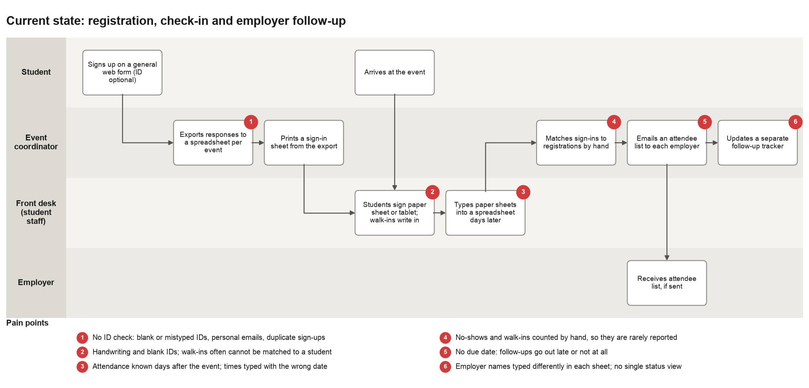
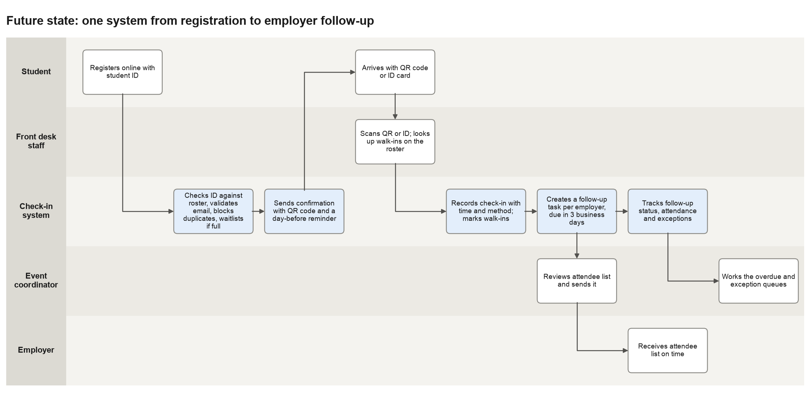

# Business requirements: event check-in and attendance system

Prepared by: Saathvik Maheshuni
Status: Draft for the office director to review

The career office in this case is made up, and every number below comes from one term of synthetic data I generated for the case (see the README). The numbers show what the reports can find. They are not measurements of a real office.

## 1. Background

The career office runs about 40 employer recruiting events a term: a career fair, information sessions, employer panels, workshops and networking nights. Registrations, door sign-ins and employer follow-ups are kept in three separate spreadsheets. Staff have to match them by hand, so attendance is only known days after each event, no-shows are rarely counted, and attendee lists reach employers late or not at all.

When I loaded one term of these spreadsheets into a database, the size of the problem was clear. 15.6% of the old rows needed a fix or were held back, 127 registration rows and 19 sign-in rows could not be matched to a student, and only 69.0% of employer follow-ups went out on time.

## 2. Goals and measures

| Goal | Measure | Starting point (synthetic term) | Proposed target |
|---|---|---|---|
| Know who attended every event on the same day | Events with attendance recorded by the end of the event day | Attendance typed up days later | All events |
| Send every employer follow-up on time | Follow-ups sent within 3 business days | 69.0% | 95% |
| Reduce no-shows | No-shows as a share of active registrations | 43.9% | Set after one term of clean data |
| Stop manual cleanup | Imported or entered rows that need a fix | 15.6% of old rows | Under 1% |

## 3. Scope

In scope: online registration, door check-in for registered students and walk-ins, waitlists, cancellations, tracking employer follow-ups, reports on attendance, no-shows, follow-ups and data quality, and a one-time move of the current spreadsheets into the new system.

Not in scope for now: self-service for employers, résumé books, appointment scheduling, and connecting to the university's single sign-on beyond looking up the roster.

## 4. Stakeholders

| Stakeholder | Role | What they need |
|---|---|---|
| Office director | Sponsor who approves the scope and targets | Attendance, no-show and follow-up numbers for the term |
| Event coordinators | Plan events and send employer follow-ups | One list of registered students and attendees, and due dates for follow-ups |
| Front-desk staff and student workers | Run the door at events | Quick check-in that also works for walk-ins |
| Students | Register and attend | Easy sign-up, a confirmation and a reminder |
| Employer recruiters | Host or attend events | A correct attendee list within 3 business days |
| Registrar (owns the roster) | Provides the student roster | The roster is only read, and no duplicate student records are created |
| University IT and privacy office | Approve hosting and how data is handled | Access control and following the rules for student records |

## 5. Current process

Main problems found in the synthetic term (outputs/05_data_quality_exceptions.csv and outputs/00_headline_metrics.csv):

- 239 registration rows had no student ID. 112 of them could be matched by school email and 127 could not.
- 89 registrations were duplicates of another row for the same student and event, and 50 more look like second sign-ups that could not be matched to a student.
- 238 registration rows had a status that was not one of the standard values, like "Cancel" or "Yes".
- 19 sign-in times were outside the event window, and 33 students signed in twice.
- 41 of the 159 walk-ins have the same name as a held registration at the same event, so some walk-ins are probably registered students whose sign-up could not be matched.
- 13 follow-ups were never sent and 9 went out late. 3 event and employer pairs were missing from the tracker completely, and 5 tracker rows spelled the employer's name differently.

## 6. New process

Students register with their student ID, and the system checks it against the roster. At the door, staff scan a QR code or ID card, or look up walk-ins on the roster. The check-in is saved right away and linked to the registration. After each event the system creates one follow-up task for each employer, due in 3 business days, and the coordinator's list shows anything that is overdue.

## 7. Functional requirements

| ID | Requirement | Priority | Checked by |
|---|---|---|---|
| FR-01 | Online registration needs a student ID that is on the roster and an email in a valid format. | Must | UAT-05, UAT-16 |
| FR-02 | Only one registration per student per event. A second attempt is blocked and shows the existing registration. | Must | UAT-04 |
| FR-03 | Staff check in a registered student by QR code or ID card, and the check-in is linked to the registration. | Must | UAT-01 |
| FR-04 | Staff check in walk-ins by looking them up on the roster. Walk-ins are saved without a registration and reported separately. | Must | UAT-02 |
| FR-05 | A student can only be checked in once per event. | Must | UAT-03 |
| FR-06 | Check-ins are accepted from 60 minutes before the start until the event ends. | Should | UAT-07, UAT-17 |
| FR-07 | When an event is full, new online registrations go on a waitlist automatically. | Should | UAT-08 |
| FR-08 | Students can cancel. Cancelled registrations are not counted as no-shows, and a check-in cannot be linked to a cancelled registration. | Must | UAT-09, UAT-18 |
| FR-09 | The attendance report shows registered, attended, walk-ins, attendance rate and no-show rate for each event. | Must | UAT-12 |
| FR-10 | Each event and employer pair gets a follow-up due 3 business days after the event, with a status of sent on time, sent late, overdue or not yet due. | Must | UAT-10, UAT-11 |
| FR-11 | Students and employers are picked from master lists, never typed in by hand. | Must | UAT-06 |
| FR-12 | A duplicate report lists confirmed and likely duplicate registrations in imported data. | Should | UAT-13 |
| FR-13 | The migration logs every old row it changes or holds back, with the reason, and a data-quality report summarizes the log. | Must | UAT-14 |
| FR-14 | Students get a confirmation with a QR code and a reminder the day before the event. | Should | Vendor build, not in the prototype |
| FR-15 | Attendee lists sent to employers only include students who agreed to share their details. | Must | Vendor build, not in the prototype |

## 8. Non-functional requirements

| ID | Requirement | Checked by |
|---|---|---|
| NFR-01 | Looking up a student at the door takes less than 2 seconds. | UAT-15 (prototype) |
| NFR-02 | Check-in keeps working if the network goes down, and syncs when it comes back. | Pilot |
| NFR-03 | Only office staff can see student contact details, and data is handled under the university's student records policy (FERPA). | Privacy office review |
| NFR-04 | Registration and check-in screens meet WCAG 2.1 AA accessibility standards. | Accessibility review |
| NFR-05 | Database rules enforce one registration and one check-in per student per event, valid links between tables, and the check-in window. No import drops a row without logging it. | UAT-03 to UAT-07, UAT-14, UAT-16 to UAT-18 |
| NFR-06 | Each check-in saves its time and method, and each follow-up saves the date it was sent. | Schema review |
| NFR-07 | A trained student worker can check in a registered student in less than 10 seconds. | Timing during the pilot |
| NFR-08 | Reports run for a fixed "as of" date so the results can be reproduced. | Schema review |

## 9. User stories and acceptance criteria

US-01. As a student, I want to register with my student ID so that my spot is saved and I get a QR code.
Given I am on the roster, when I enter my ID and a valid email, then my registration is confirmed. Given I already registered, when I try again, then I see my existing registration instead of getting a second one. Given the event is full, when I register, then I am put on the waitlist and told about it.

US-02. As front-desk staff, I want to scan a QR code or ID card so that each check-in only takes a few seconds.
Given a registered student, when I scan their code, then they are checked in and linked to their registration. Given a student who is already checked in, when I scan again, then I see "already checked in" and nothing new is added. Given a scan more than 60 minutes before the start, then it is refused.

US-03. As front-desk staff, I want to check in walk-ins by looking them up on the roster so that everyone who attends is counted.
Given a student on the roster with no registration, when I find them by ID or name, then they are checked in as a walk-in. Given someone who is not on the roster, then the system does not create a student record and tells me to send them to the office.

US-04. As an event coordinator, I want an attendance report on the day of the event so that I can send employers a correct list.
Given check-ins are saved, when I open the report, then it shows registered, attended, walk-ins, attendance rate and no-show rate, and cancelled registrations are not counted as no-shows.

US-05. As an event coordinator, I want a follow-up task with a due date for each employer so that none get missed.
Given an event with employers, when the event ends, then one task per employer is created, due in 3 business days. Given a task that is past its due date and not sent, then it shows as overdue on my list.

US-06. As an employer recruiter, I want the attendee list within 3 business days so that I can contact students while the event is still fresh.
Given the coordinator sends the list, then the date it was sent is saved and the task shows as sent on time or sent late.

US-07. As the office director, I want no-show and follow-up numbers for the term so that I can see which events and practices work.
Given a term of data, when I open the summary, then I see the no-show rate by event type and by how early students registered, and the share of follow-ups sent on time.

US-08. As the data owner, I want every imported row that was changed or held back to be logged so that nothing disappears without a record.
Given the old spreadsheets are loaded, then each fix or rejected row shows up in the exceptions log with the source row and what was done, and the counts match the source spreadsheets.

## 10. Data and reports

The data model and every field are described in data_dictionary.md. The prototype reports are in sql/: attendance rate by event (01), no-show rate (02), duplicate registrations (03), employer follow-up status (04), data-quality problems (05) and check-in arrival times (06). In the synthetic term, 39.6% of check-ins came in the first 10 minutes after the start, and 74.4% of students had arrived by then. So the door should have the most staff from 15 minutes before the start to 10 minutes after.

## 11. Assumptions, constraints and open questions

Assumptions: the registrar can send a roster file every day, students carry an ID card or phone, and events are held in rooms with Wi-Fi.

Constraints: I assumed there is no budget for custom development, so the requirements are written so that a vendor product or an existing campus system can meet them.

Open questions for the director: Who owns the employer list? Should waitlisted students move up automatically when someone cancels? How long should attendance records be kept? Should reminders go out one day or two days before the event?
